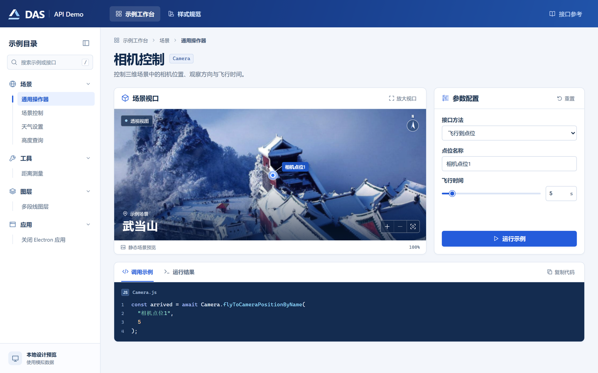

# APIDemo 蓝白色工作台设计

2026-11-24 确认了这版蓝白色设计方向。后续扩展接口页面时，沿用同一套目录、场景视口、参数表单和调用示例布局。

## 本地预览

在本地仓库中用浏览器打开 [index.html](./index.html) 即可体验。预览使用项目自带的武当山场景图和模拟返回值，可以离线使用。

默认示例为「场景 → 通用操作器 → 相机控制」。修改点位名称或飞行时间，下方的 JavaScript 调用代码会同步更新。点击「运行示例」可查看模拟结果。顶部的「样式规范」展示色板、文字层级和控件状态。

## 布局与配色

- **桌面**采用左侧示例目录、中间场景视口和右侧参数表单，下方保留完整宽度展示代码或运行结果。调整参数时可同时看到场景。
- **窄屏**在视口宽度不超过 900 px 时将目录收进抽屉，不超过 700 px 时将场景、参数和代码上下排列。
- **主操作**与选中状态使用交互蓝 `#245CDB`。导航和表单使用白底 `#FFFFFF`，工作区使用雾蓝灰 `#F3F6FB`，面板用 `#DCE4EF` 细线分隔。代码区使用深海蓝 `#142C50`。
- **示例范围**涵盖场景、工具、图层、应用四类，共 7 个代表性示例、9 个接口方法。本版用于评审界面和交互，实际 UE 调用仍由项目中的 Vue 示例执行。
